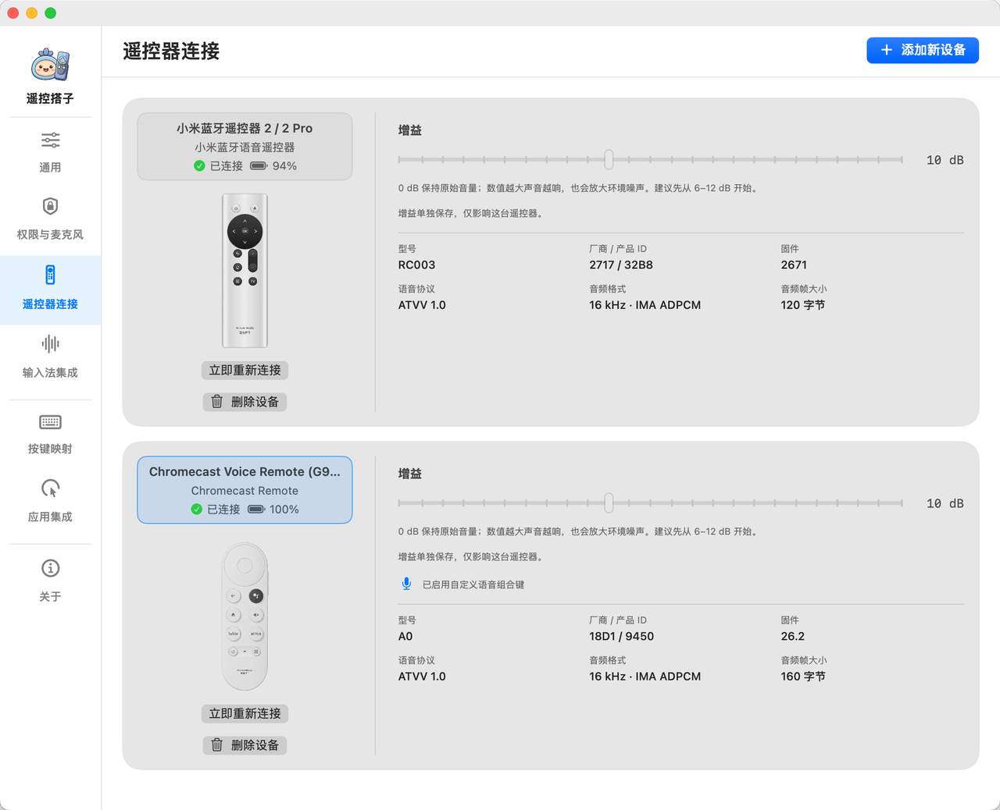
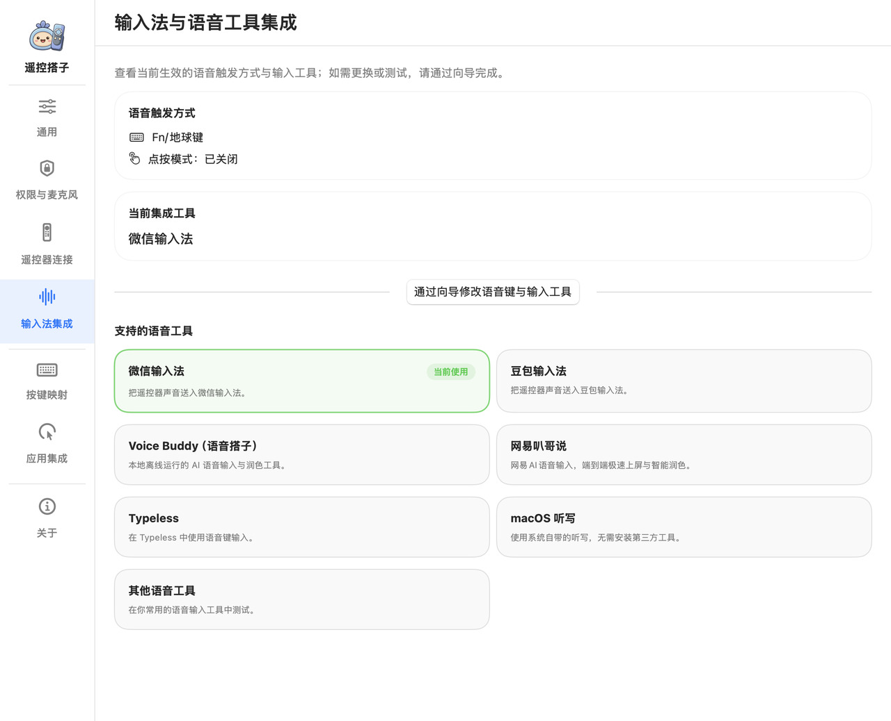
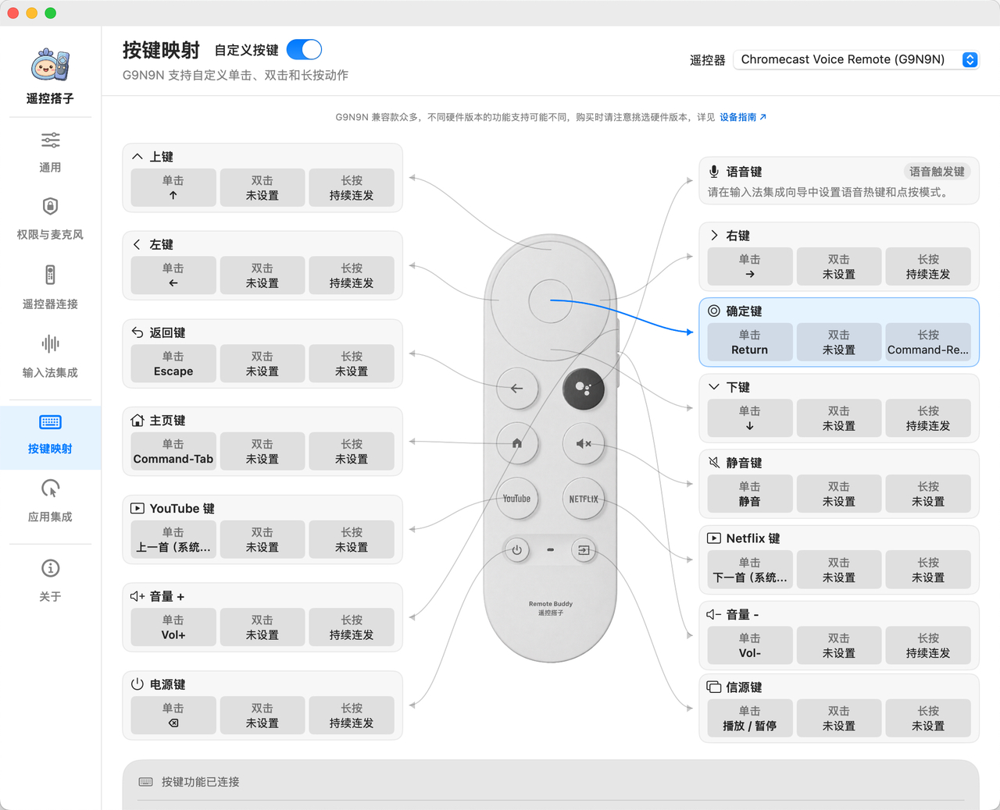

# Remote Buddy

[简体中文](README.md) | **English**

Turn a remote control into a voice-input button for your computer. Press to talk, release to finish, and let your preferred input method or dictation tool enter text into the current field.

[Website](https://remote.zfdang.com/index.en.html) · [Downloads](https://github.com/zfdang/remote-buddy/releases) · [Device Guide](https://remote.zfdang.com/device_en.html) · [FAQ](https://remote.zfdang.com/faq_en.html)

This repository is the native **macOS 14 and later** edition (Apple Silicon and Intel Macs). For **Windows 10/11**, please visit the companion open-source project [Remote Buddy for Windows](https://github.com/zfdang/remote-buddy-windows) (built with .NET 10 LTS C# / WPF + VB-CABLE, featuring full ATVV protocol support and button mapping for G9N9N, Xiaomi, and other remotes).

## Screenshots

### Remote connections



---

### Voice tool integration



---

### Button mapping



## What can it do?

- Use a remote's microphone for voice input, without reaching for the keyboard. G9N9N defaults to **Smart Toggle** (hands-free tap) alongside Hold-to-Talk, and both G9N9N and T1 exceed the 60-second limit with keepalive up to ~5 minutes.
- Map supported remote buttons to keyboard shortcuts, application actions, or common phrases: includes expanded system, basic, and app presets (such as direction-key passthrough, Reload `Command+R`, and shortcut badges), category filtering, independent single/double/long-press actions, and individual trigger reset. Common phrases work on configurable keys (including the G9N9N Power button), preserve authored whitespace/newlines, support mixed languages, and stay unchanged when switching UI language.
- Configure `Fn` or a custom voice shortcut with hold-to-talk or tap-to-toggle behavior for your input tool, with an optional "Bypass Input Source Switching" toggle for global-shortcut IMEs.
- Optional app integrations preserve your selected editable input in WeChat, Antigravity, ChatGPT, Claude, DeepSeek, and WorkBuddy, locating the conversation input only when needed, with individual and bulk switches.
- Set up permissions, the microphone driver, device connection, and input integration in one guide; Connection settings display the hardware **HID version** to help distinguish batches, and the status bar menu adds a **System Default Microphone** submenu below **Open Settings…** to inspect and switch macOS's default input device live (with a built-in note recommending selecting `Remote Buddy Mic` only inside your voice tool for everyday use).

Each newly added remote starts with its model defaults. Saved custom mappings belong to that device; mappings from other devices or before pairing are not copied.

Remote Buddy does not collect usage statistics, save recordings or transcript history, or upload logs. Recognition and text cleanup are handled by your selected input tool, with that tool's own network and privacy settings.

Enabling any app integration makes Remote Buddy send the Fn hold trigger for all foreground apps, requiring Accessibility permission so focus can finish first. Only enabled foreground apps have their focus adjusted. Focusing is optional: if it fails, voice input continues and you can use Command+V to paste the result if needed. Disable all integrations to restore the original trigger behavior. Antigravity integration targets the Agent desktop app, not the separate Antigravity IDE.

## How does it work?

```text
Remote microphone → Bluetooth audio → Remote Buddy → Virtual microphone → Input tool
Remote voice button → Remote Buddy → Voice shortcut → Text in the current field
```

The app decodes remote audio and sends it to a virtual microphone while triggering the selected tool's voice shortcut. It connects hardware to input software; it does not run its own speech-recognition model. Live transcription, recognition speed, and corrections depend on the input tool.

## How do I use it?

Download `Remote_Buddy_*.pkg` from [GitHub Releases](https://github.com/zfdang/remote-buddy/releases) or the [website download mirror](https://remote.zfdang.com/downloads/index.en.html). One installer includes both the app and its virtual microphone driver.

1. Install and open `/Applications/Remote Buddy.app`.
2. Follow the guide to grant Bluetooth, Input Monitoring, and Accessibility permissions. The app follows your system language by default; you can choose English or Chinese on the first screen.
3. Select and connect your remote, test its buttons, and wait for the driver and fixed output checks to pass. Select **Remote Buddy Mic** in your input tool. The app uses this device automatically, without an output picker or fallback to BlackHole or speakers.
4. Configure the tool's voice shortcut (`Fn` or custom shortcut) under **Integration**, then test it with the guide.
5. Focus a text field and use your remote's voice trigger: G9N9N defaults to Smart Toggle (tap once for hands-free listening and press again to stop, or hold >0.7s to stop on release), T1 presses once to start and again to stop, and Xiaomi requires holding while speaking. Adjust the start/stop behavior for tap-based tools such as Typeless.

On the Connections page, remove an unused remote and its saved app settings. Its macOS Bluetooth pairing remains; choosing Add Device may rediscover previously removed remotes.

Configure single, double, and long presses for Xiaomi, T1, and validated G9N9N versions under **Buttons**. Use **Run Setup Guide Again** at the top of **General** settings to repeat validation. G9N9N hardware/firmware batches vary; check the **HID version** in **Connections** after pairing, and see the [G9N9N Compatibility Guide](https://remote.zfdang.com/g9n9n-compatibility_en.html) ([Chinese repo guide](docs/g9n9n-compatibility.md)).

Driver installation requires administrator authorization and briefly interrupts audio; upgrades where the driver has not changed skip restarting macOS audio services. Current installers are not Apple-notarized and may be blocked by macOS. See [installation and release notes](docs/releases.md).

## Which devices are supported?

| Device | Must the physical voice button stay held? | Status |
| --- | --- | --- |
| Google Chromecast Voice Remote (G9N9N) | **No (Smart Toggle by default)**; tap to talk hands-free (press again or another button to stop), or hold >0.7s to stop on release; can switch to pure Hold to Talk; no 60s cap (keepalive up to ~5 min); bottom white LED glows while streaming | **Supported (Recommended)**: check **HID version** and firmware revision in Connections after pairing (`0x0110` alone does not guarantee single-key support) — `0x0110 / FW 26.2` **Fully Supported** (voice + 14 buttons with single/double/long press & common phrases + battery level); `A0 / FW 26.7` & `0x0110 / FW 26.0` (`CR PVT/MP`, see [#256](https://github.com/zfdang/remote-buddy/issues/256), possibly a distinct hardware/firmware variant) **Partially Supported** (2-key compatibility mode: voice + Arrow + OK for Enter); `0x011B` voice-only (ordinary buttons dropped by macOS before `IOHID`; a verified single-key batch recommended). [Website guide](https://remote.zfdang.com/g9n9n-compatibility_en.html) · [Chinese notes](docs/g9n9n-compatibility.md) |
| Xiaomi Bluetooth Remote 2 / 2 Pro | **Yes**; hold to talk, release to stop (~60s single-hold limit) | **Supported**: `RC001` = Remote 2 (replaceable batteries), `RC003` = 2 Pro (USB-C rechargeable); identical voice and full button-mapping (single/double/long press) functionality |
| T1 Air-Mouse & Keyboard Voice Remote (and compatible clones) | **No** on the tested sample; press once to start, press again to stop (no 60s cap; keepalive up to ~5 min) | **Supported**: requires **direct Bluetooth** (not the 2.4 GHz USB receiver); 7 front buttons remappable, D-pad/OK, rear QWERTY keyboard, and air mouse pass through. Clones require individual verification. [Hardware notes](docs/t1-remote-hardware-debugging.md) (Chinese) |
| Google TV Streamer Voice Remote (GY3LE) | Not supported yet; Mac voice interaction unverified | Planned; adapter implementation and hardware validation pending |
| Apple Siri Remote | Not supported yet; Mac voice interaction unverified | Planned; adapter implementation and hardware validation pending |

See the **[Supported Remotes & Buying Guide](https://remote.zfdang.com/device_en.html)** for real photos, three-remote size comparisons, features, reference prices, and store links (see also [repo device archive](devices/supported-devices.md), Chinese). Changing the input tool to start/stop taps does not keep a pure push-to-talk remote (such as Xiaomi) recording after its physical button is released.

Unsure which remote to pick? Check the website comparison and buying guide above, or see our earlier [Xiaomi 2 Pro vs T1 Remote Comparison](devices/xiaomi-2pro-vs-t1-remote.md) (Chinese) with photos, dimensions, and voice-input differences.

The device scope is limited to these five entries. Google hardware model numbers follow [Google's regulatory documentation](https://support.google.com/product-documentation/answer/4541589?hl=en). Third-party replacements require separate validation; a seller's “compatible with G9N9N” label does not establish support.

Bluetooth pairing alone does not establish compatibility: the remote must use a supported button and audio protocol.

## Which input methods and tools can I use?

| Tool | Integration |
| --- | --- |
| [WeType / WeChat Input Method](https://z.weixin.qq.com/) | Dedicated setup entry with virtual microphone and voice shortcut |
| [Doubao Input Method](https://shurufa.doubao.com/) | Dedicated setup entry with hold and tap behavior |
| [Tencent Chatterfly](https://chatterfly.tencent.com/) | Hold-to-talk only; enable global voice shortcuts, select Remote Buddy Mic, and verify with the guide |
| [Voice Buddy](https://myvoicebuddy.com/en.html) | 100% local offline AI voice input & polish tool on Apple Silicon, supporting Hold and Toggle modes with virtual microphone and `Fn` trigger |
| [NetEase Bageshuo](https://bug.youdao.com/) | Dedicated setup entry with voice shortcut and microphone configuration |
| Typeless | Configure its voice shortcut and start/stop behavior |
| macOS Dictation | Built in, no third-party app; set the shortcut to Press 🌐 Twice. Holding the remote presses Fn twice to start, and releasing it presses Fn once to stop |
| Other voice-input tools | Configure a custom shortcut under Other Tools |

The tool must accept the virtual microphone and expose a usable voice shortcut (`Fn` or custom shortcut in Integration settings, with optional "Bypass Input Source Switching" for global-shortcut IMEs). Versions and settings vary: verify the actual behavior with the guide. A configuration entry does not mean every version has been tested.

## More information

- [FAQ & Troubleshooting](https://remote.zfdang.com/faq_en.html)
- [G9N9N Compatibility Guide](https://remote.zfdang.com/g9n9n-compatibility_en.html) ([Chinese repo notes](docs/g9n9n-compatibility.md))
- [Interface and troubleshooting](docs/interface.md)
- [Website and deployment](docs/website.md)
- [Development and builds](docs/development.md)
- [Builds and fixed signing certificates](docs/build-and-signing.md)
- [Releases and installers](docs/releases.md)
- [Architecture and scope](docs/architecture.md)
- [Privacy and testing](docs/privacy-and-testing.md)
- [Remote Buddy for Windows](https://github.com/zfdang/remote-buddy-windows)
- [Source provenance](docs/provenance.md), [GPL-3.0-only license](LICENSE), [third-party notices](THIRD_PARTY_NOTICES.md)

## Download and uninstall

Download from [GitHub Releases](https://github.com/zfdang/remote-buddy/releases) or the [website download mirror](https://remote.zfdang.com/downloads/index.en.html): choose `*_macOS_arm64.pkg` for Apple Silicon or `*_macOS_intel.pkg` for Intel. Each contains the app and its **Remote Buddy Mic** driver.

To uninstall, download `Remote_Buddy_Uninstaller_*_macOS_universal.pkg` (works on both architectures) and open the package in macOS Installer. The default removes the app, driver, and your settings, logs and caches. Uncheck the personal-data removal option to retain settings and logs. Installer’s fixed **Install** button executes uninstall actions; no software is installed. Administrator authorization is required; audio briefly restarts. See [uninstallation details](docs/uninstall.md).

## References

| Project / module | Role |
| --- | --- |
| [remote-mic-app](https://github.com/HD838A/remote-mic-app) | Code foundation for remote connectivity, audio bridging, button mappings, and interface |
| [remote-bridge-hub](https://github.com/xxb26553663-star/remote-bridge-hub) | Xiaomi ATVV protocol, ADPCM decoding, and HID mapping reference |
| [vibe-mote](https://github.com/Tilkmilk/vibe-mote) | Reference for Google TV / Chromecast remote HID buttons, ATVV audio, and third-party replacement differences (Windows implementation) |
| [ATVVoice](https://github.com/b0o/ATVVoice) | Linux implementation with verified G9N9N support; ATVV negotiation, synchronization, and keepalive reference |
| [mi-remote-mapper](https://github.com/81199000/mi-remote-mapper) | macOS CoreBluetooth, HID, and virtual audio reference; not G9N9N hardware acceptance evidence |
| [mi-ao](https://github.com/fanxeon/mi-ao) | macOS ATVV decoding and capability validation reference; unverified models such as GY3LE still require hardware validation |
| [mi_remote_control](https://github.com/godarrenw/mi_remote_control) | Reference for button actions, application profiles, and troubleshooting |
| [open-voice-bridge](https://github.com/nijez/open-voice-bridge) | Reference for device capability modeling and audio-path diagnostics |
| [BlackHole](https://github.com/ExistentialAudio/BlackHole) v0.7.2 | Virtual microphone driver |
| [MiRemoteVoice](https://github.com/VincentKingHsu/MiRemoteVoice) | USB-transport loopback compatibility design reference |
| [Sparkle](https://github.com/sparkle-project/Sparkle) 2.10.1 | macOS in-app updates with signed combined installers |
| [codex-siri-remote](https://github.com/luobosibing2/codex-siri-remote) | Historical reference for Apple remote HID and touch behavior |
| [SiriRemoteForge](https://github.com/HOLODATA-COM/SiriRemoteForge) | Historical reference for Apple remote audio and PacketLogger formats |
| [iRemote A2854](https://github.com/DaviBaum/iRemote-A2854) | Historical reference for Apple remote diagnostics and authorization |
| [Opus](https://www.opus-codec.org/) | Codec referenced by historical Apple remote compatibility code; its dynamic library is not included in the current installer |

Historical references do not imply current Apple remote support. See the [module inventory](docs/modules.md) for internal modules and macOS frameworks, and [third-party notices](THIRD_PARTY_NOTICES.md) for versions, copyrights, and licenses.

## Trademarks and non-affiliation

Remote Buddy is an independent open-source project and is not affiliated with, endorsed by, or sponsored by **IOSPIRIT GmbH**, Apple Inc., Google LLC, Xiaomi Corporation, or Existential Audio Inc. All third-party product names, hardware models, and trademarks belong to their respective owners and are mentioned solely to describe compatibility.
