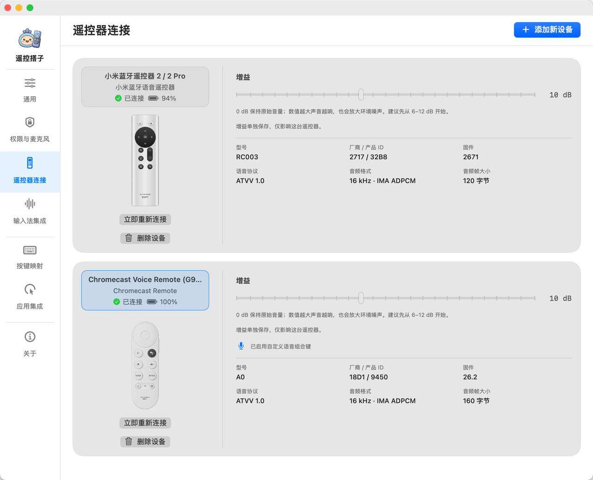
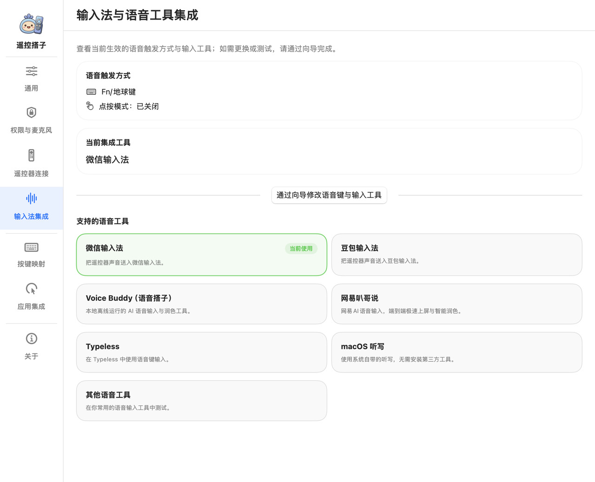
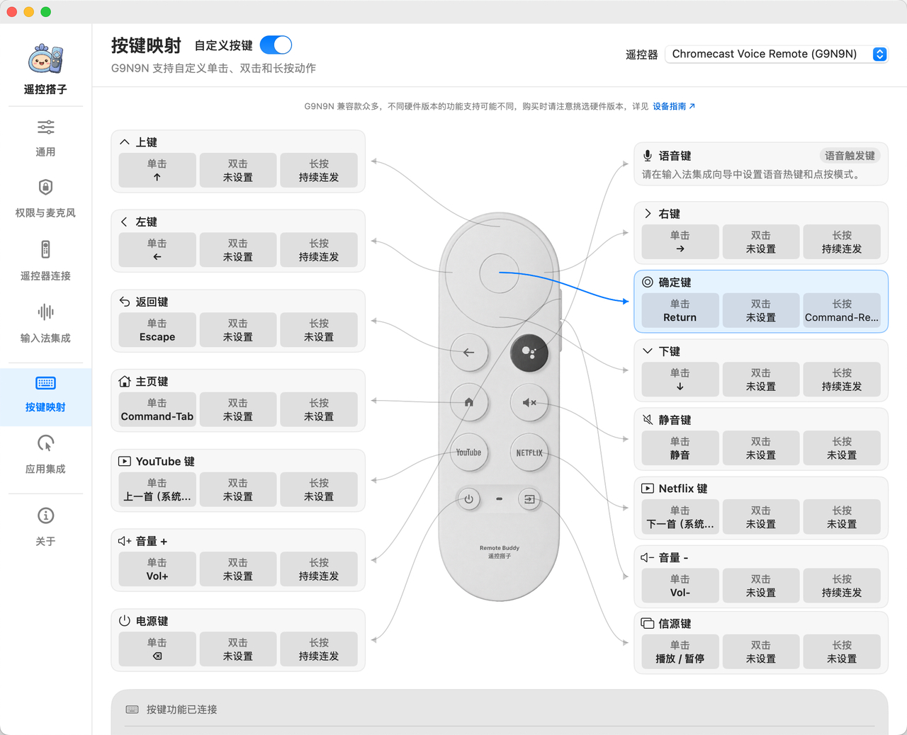

# Remote Buddy

**简体中文** | [English](README.en.md)

Remote Buddy（遥控搭子）把遥控器变成电脑上的语音输入按钮。拿起遥控器，按下说话、松开结束，就能在当前输入框中使用你喜欢的输入法或听写工具。

[产品官网](https://remote.zfdang.com) · [下载](https://github.com/zfdang/remote-buddy/releases) · [设备指南](https://remote.zfdang.com/device.html) · [常见问答 (FAQ)](https://remote.zfdang.com/faq.html)

本仓库为原生 **macOS 14 及以上版本**（支持 Apple Silicon 和 Intel Mac）。Windows 10/11 请移步同源开源项目 [Remote Buddy for Windows](https://github.com/zfdang/remote-buddy-windows)（基于 .NET 10 LTS C# / WPF + VB-CABLE 构建，完整支持 ATVV 协议与 G9N9N / 小米遥控器等设备按键映射）。

## 界面预览

### 遥控器连接



---

### 输入法集成



---

### 按键映射



## 能做什么

- 用遥控器麦克风进行语音输入，减少对电脑键盘和内置麦克风的依赖。G9N9N 默认支持**智能切换（点按免提）**与按住说话双模式；T1 已测样机与 G9N9N `0x0110 / 固件 26.2` 均支持通过 `MIC_EXTEND` 保活突破 60 秒上限（主机默认约 5 分钟保护性停麦，可在「通用」中调整），而部分兼容批次（如 `0x011B` 杰理方案）会忽略保活并在约 60.6 秒静默断流（详见[兼容指南](docs/g9n9n-compatibility.md)）。
- 把支持型号的普通按键映射成快捷键、应用操作或常用语：内置丰富的系统、基础与应用动作预设（含方向键直通、刷新 `Command+R` 等，并展示快捷键徽章），支持分类筛选、单击/双击/长按独立配置与单项恢复默认。常用语支持 G9N9N 电源键等可配置键位，保留作者录入的空格与换行，不随界面语言切换，可自由混写中英文。
- 选择语音输入工具，配置 `Fn` 或自定义语音快捷键及按住说话／点按开始结束方式；对于依赖全局快捷键的输入法，可选启用“跳过输入法切换”。
- 可选的应用集成：在微信、Antigravity、ChatGPT、Claude、DeepSeek 和 WorkBuddy 中，优先使用你选中的输入框；没有选中时才定位当前对话输入框；支持分别开关或全部开关。
- 在一个向导中完成系统权限、麦克风驱动、遥控器连接和输入工具设置；连接页展示硬件 **HID 版本** 便于鉴别批次，状态栏菜单「打开设置」下方还提供 **系统默认麦克风** 子菜单，可实时查看并按需一键切换系统默认输入设备（附提示：日常语音输入仍建议仅在对应输入工具内选择 `Remote Buddy Mic`）。

每台新添加的遥控器从该型号的默认映射开始。保存后的自定义属于这台设备；不会复制其他设备或尚未绑定设备时的配置。

应用不采集使用统计，不保存录音或文本历史，不上传日志。语音识别和文本整理交给所选输入工具，其联网行为由该工具的设置决定。

在“应用集成”中开启任一应用后，Fn 按住模式会在所有前台应用中改由遥控搭子发送触发键，以保证先聚焦再触发，需要辅助功能权限。只有已开启集成的前台应用会调整焦点；聚焦失败时仍继续语音输入，必要时可用 Command+V 粘贴结果。全部关闭后恢复原有触发行为。Antigravity 集成针对 Agent 桌面应用，不包含单独的 Antigravity IDE。

## 工作原理

```text
遥控器麦克风 → 蓝牙音频 → Remote Buddy → 虚拟麦克风 → 输入法／听写工具
遥控器语音键 → Remote Buddy → 触发工具的语音快捷键 → 当前输入框
```

Remote Buddy 接收遥控器音频，解码后送入虚拟麦克风，同时将按键动作转换成目标工具需要的快捷键。它负责连接硬件与输入工具，本身不运行语音识别模型。实时文字、识别速度和自动修正效果取决于所选工具。

## 如何使用

从 [GitHub Releases](https://github.com/zfdang/remote-buddy/releases) 或[官网下载镜像](https://remote.zfdang.com/downloads/index.html)下载 `Remote_Buddy_*.pkg`。一个安装包包含 App 和虚拟麦克风驱动。

1. 安装后打开 `/Applications/Remote Buddy.app`。
2. 按设置向导授予蓝牙、输入监控和辅助功能权限。首次默认跟随系统语言，可在第一步选择中文或英文。
3. 选择并连接遥控器、测试按键，等待驱动检查与固定输出准备就绪，再在输入工具中选择 **Remote Buddy Mic** 虚拟麦克风。App 自动使用该设备，不需要选择输出，也不回退到 BlackHole 或扬声器。
4. 在“输入法集成”中配置语音快捷键（`Fn` 或自定义快捷键），通过向导测试。
5. 打开文本输入框，按对应遥控器的语音方式说话：G9N9N 默认短按免提（再按停止）、长按超 0.7 秒松手即停，T1 为点按开始/再按结束，小米需按住说话松手停止。使用 Typeless 等单击触发的工具，可在设置中调整开始／结束行为。

在“遥控器连接”页面可删除不再使用的遥控器及其应用内配置；macOS 蓝牙配对不会被删除。选择“添加设备”后，之前删除的设备可能被重新发现。

小米、T1 与已验证版本的 G9N9N 可在“按键映射”中配置普通按键的单击、双击和长按。重新检查环境可在**通用设置**顶部运行向导。G9N9N 兼容款存在不同硬件与固件批次，连上 Mac 后可在“遥控器连接”查看 **HID 版本**鉴别，详见 [G9N9N 使用指南](docs/g9n9n-compatibility.md) 或[官网兼容性说明](https://remote.zfdang.com/g9n9n-compatibility.html)。

安装需要管理员授权；首次安装或驱动变化、修复时会短暂中断音频，驱动未变化的升级会跳过音频服务重启。当前安装包未经过 Apple 公证，系统可能阻止安装。详见 [安装与发布说明](docs/releases.md)。

## 支持哪些设备

| 设备与型号 | 状态 | 语音键支持 | 语音时长限制 | 普通键支持 | 购买链接 | 其他说明 |
| --- | --- | --- | --- | --- | --- | --- |
| Google Chromecast Voice Remote（G9N9N） | **已支持（优先推荐）** | **点按、长按**（默认智能切换：短按免提再按停，长按 >0.7 秒松手停；可切纯长按） | **按批次而异**：`0x0110 / 26.2` 支持保活**可配置**（通用 3–30 分钟，默认 5 分钟，实测 68.9s）；`0x011B` 等部分兼容款约 **60s**（60.6s 静默断流，[#280](https://github.com/zfdang/remote-buddy/issues/280)） | **14 键全映射**：`0x0110 / 26.2` 原生 HID 即插即用；短报文批次（`26.7`/`26.0`/`0x011B`）启用蓝牙日志恢复（`.mobileconfig`） | 实购约 ¥15，[拼多多参考](https://mobile.yangkeduo.com/goods.html?ps=wI005ehWCi) | 理论上日志恢复可绕过 macOS 限制支持任何硬件，未见过的新批次仍需单独适配；[兼容指南](docs/g9n9n-compatibility.md) · [网页说明](https://remote.zfdang.com/g9n9n-compatibility.html) |
| 小米蓝牙遥控器 2／2 Pro（`RC001` / `RC003`） | **已支持** | **仅长按**（按住说话，松手停止） | **约 60s**（硬件固件上限） | **全控制键映射**（单击/双击/长按/常用语，原生 HID） | 2 Pro 日常 ~¥99，[小米有品](https://www.xiaomiyoupin.com/detail?gid=183179) | `RC001` = 2（干电池），`RC003` = 2 Pro（Type-C 充电）；两者语音与按键功能一致 |
| T1 飞鼠键盘语音遥控器（含同款兼容版） | **已支持** | **点按**（已测样机按一下开始，再按一下结束） | **可配置**（已测样机实测近 2 分钟；通用 3–30 分钟，默认 5 分钟；兼容批次需另行验证） | **7 颗正面键映射** + 方向/OK、背面全键盘与飞鼠直通 | 约 ¥50，[淘宝搜索](https://s.taobao.com/search?q=T1%20%E8%93%9D%E7%89%99%20%E9%A3%9E%E9%BC%A0%20%E8%AF%AD%E9%9F%B3) | 须**蓝牙直连**（非 2.4G 接收器）；兼容批次需另行验证；[真机记录](docs/t1-remote-hardware-debugging.md) |
| Google TV Streamer Voice Remote（GY3LE） | **计划支持** | 尚未支持 | — | 尚未支持 | [Google Store](https://store.google.com/product/google_tv_streamer_remote?hl=en-US) | 尚未完成适配与真机验证 |
| Apple Siri Remote | **计划支持** | 尚未支持 | — | 尚未支持 | [Apple Store](https://www.apple.com/shop/product/mlfc4am/a/siri-remote) | 尚未完成适配与真机验证 |

完整型号、实拍外观、三款尺寸对比、按键说明、参考价格与购买入口见 **[官网遥控器设备与选购指南](https://remote.zfdang.com/device.html)**（仓库内亦有[设备说明档案](devices/supported-devices.md)）。输入法的“点按开始/结束”设置不会让**纯按住型遥控器（如小米）**在松手后继续收音。

不知道怎么挑选？可查看官网指南中的三款实拍与选购建议，也可参考早期对比文章：[小米蓝牙遥控器 2 Pro vs T1 飞鼠键盘遥控器：对比与选购建议](devices/xiaomi-2pro-vs-t1-remote.md)（包含体积厚度实拍、功能与语音输入差异）。

设备范围限定为以上五项。Google 硬件型号依据 [Google 官方监管信息](https://support.google.com/product-documentation/answer/4541589?hl=en)。第三方兼容款必须单独验证，商品标注“兼容 G9N9N”不代表已经支持。

遥控器需支持对应的蓝牙按键与音频协议，不能仅凭“可以蓝牙配对”判断兼容。

## 支持哪些输入法与工具

| 输入工具 | 集成方式 |
| --- | --- |
| [微信输入法](https://z.weixin.qq.com/) | 专用配置向导入口，配合虚拟麦克风与语音快捷键 |
| [豆包输入法](https://shurufa.doubao.com/) | 专用配置向导入口，支持按住与点按触发设置 |
| [腾讯Chatterfly](https://chatterfly.tencent.com/) | 仅按住说话，开启快捷键全局可用并选择 Remote Buddy Mic；按向导实际验证 |
| [Voice Buddy（语音搭子）](https://myvoicebuddy.com/) | 100% 本地离线 AI 语音输入与润色工具，支持按住说话与点按切换，配合虚拟麦克风与 `Fn` 触发 |
| [网易叭哥说](https://bug.youdao.com/) | 专用配置向导入口，配置语音快捷键与麦克风 |
| Typeless | 配置其语音快捷键及开始／结束行为 |
| macOS 听写 | 系统自带，无需安装第三方工具；快捷键设为“按两下 🌐 键”，按住遥控器时连按两次 Fn 开始，松开后按一次 Fn 结束 |
| 其他语音输入工具 | 使用“其他工具”配置自定义快捷键 |

目标工具需要能够接收虚拟麦克风音频，并支持可以触发的语音快捷键（可在设置中选择 `Fn` 或自定义热键；对于全局快捷键输入法，可启用“跳过输入法切换”）。每个工具的版本和设置可能不同，请通过向导实际测试；配置入口不代表所有版本都已验证兼容。

## 更多信息

- [常见问答与排障 (FAQ)](https://remote.zfdang.com/faq.html)
- [G9N9N 兼容性与版本说明](docs/g9n9n-compatibility.md)
- [界面与常见问题](docs/interface.md)
- [官网与部署](docs/website.md)
- [开发与构建](docs/development.md)
- [构建与固定签名证书](docs/build-and-signing.md)
- [发布与安装包说明](docs/releases.md)
- [架构与产品范围](docs/architecture.md)
- [隐私与验证记录](docs/privacy-and-testing.md)
- [Remote Buddy for Windows](https://github.com/zfdang/remote-buddy-windows)
- [源码来源](docs/provenance.md)、[GPL-3.0-only 许可证](LICENSE)、[第三方声明](THIRD_PARTY_NOTICES.md)

## 下载与卸载

可从 [GitHub Releases](https://github.com/zfdang/remote-buddy/releases) 或[官网下载镜像](https://remote.zfdang.com/downloads/index.html)下载：Apple Silicon 选择 `*_macOS_arm64.pkg`，Intel 选择 `*_macOS_intel.pkg`。每份包含 App 和 **Remote Buddy Mic** 驱动。

卸载时下载通用的 `Remote_Buddy_Uninstaller_*_macOS_universal.pkg`（Apple Silicon / Intel 共用），通过 macOS Installer 打开。默认删除 App、驱动和当前用户设置、日志、缓存；取消勾选个人数据删除选项即可保留设置与日志。系统固定的“安装”按钮实际执行卸载，不安装程序。需要管理员认证，音频服务会短暂重启。详见[卸载说明](docs/uninstall.md)。

## References

| 项目 / 模块 | 用途 |
| --- | --- |
| [remote-mic-app](https://github.com/HD838A/remote-mic-app) | 遥控器连接、音频桥接、按键映射与界面的代码基础 |
| [remote-bridge-hub](https://github.com/xxb26553663-star/remote-bridge-hub) | 小米 ATVV 协议、ADPCM 解码和 HID 映射参考 |
| [vibe-mote](https://github.com/Tilkmilk/vibe-mote) | Google TV／Chromecast 遥控器 HID 按键、ATVV 语音协议与第三方兼容款差异的参考（Windows 实现） |
| [ATVVoice](https://github.com/b0o/ATVVoice) | 已验证 G9N9N 的 Linux ATVV 实现；能力协商、音频同步与会话保活参考 |
| [mi-remote-mapper](https://github.com/81199000/mi-remote-mapper) | macOS CoreBluetooth、HID 和虚拟音频输出参考；未作为 G9N9N 真机验收依据 |
| [mi-ao](https://github.com/fanxeon/mi-ao) | macOS ATVV 协议、解码与能力验证参考；GY3LE 等未验收型号仍需真机验证 |
| [mi_remote_control](https://github.com/godarrenw/mi_remote_control) | 按键动作、应用预设与故障排查的设计参考 |
| [open-voice-bridge](https://github.com/nijez/open-voice-bridge) | 设备能力建模与语音链路诊断的设计参考 |
| [BlackHole](https://github.com/ExistentialAudio/BlackHole) v0.7.2 | 虚拟麦克风驱动 |
| [MiRemoteVoice](https://github.com/VincentKingHsu/MiRemoteVoice) | USB transport 回环音频设备的兼容设计参考 |
| [Sparkle](https://github.com/sparkle-project/Sparkle) 2.10.1 | macOS 应用内更新，验证一体安装包的签名 |
| [codex-siri-remote](https://github.com/luobosibing2/codex-siri-remote) | Apple 遥控器 HID 与触摸行为的历史参考 |
| [SiriRemoteForge](https://github.com/HOLODATA-COM/SiriRemoteForge) | Apple 遥控器音频与 PacketLogger 格式的历史参考 |
| [iRemote A2854](https://github.com/DaviBaum/iRemote-A2854) | Apple 遥控器诊断与授权流程的历史参考 |
| [Opus](https://www.opus-codec.org/) | Apple 遥控器音频兼容代码涉及的编解码器；当前安装包不包含其动态库 |

历史兼容代码的引用不代表当前支持 Apple 遥控器。系统框架和内部模块详见 [模块清单](docs/modules.md)，各模块版本、版权及许可见 [第三方声明](THIRD_PARTY_NOTICES.md)。

## 商标与免责声明

Remote Buddy（遥控搭子）是一个独立的开源软件项目，与 **IOSPIRIT GmbH**（同名商业软件 Remote Buddy 的商标持有者）、Apple Inc.、Google LLC、Xiaomi Corporation（小米）或 Existential Audio Inc. 无任何关联、授权、赞助或背书关系。文中提及的第三方产品名称、型号、图标与商标均归各自所有者所有，仅用于说明设备与系统兼容性。

## Star History

[](https://star-history.com/#zfdang/remote-buddy&Date)
