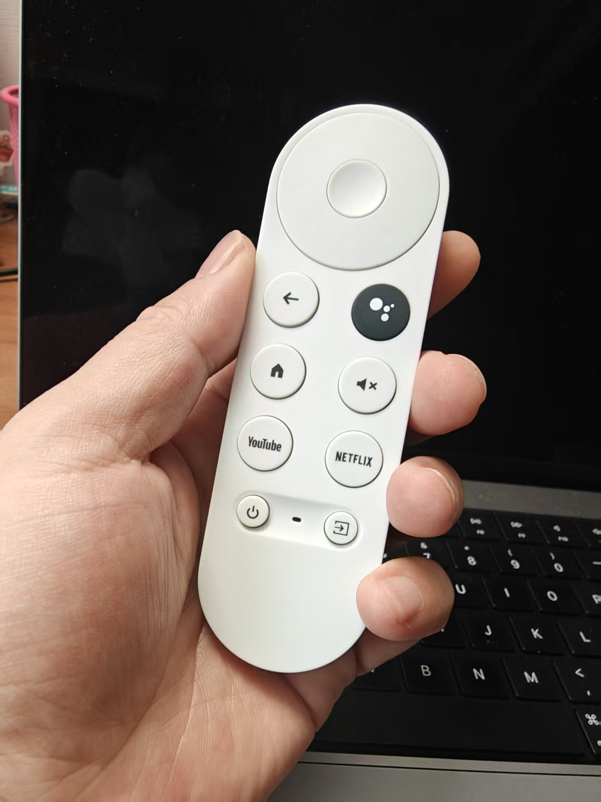

# 遥控器设备指南

更新日期：2026-11-16。本文记录 Remote Buddy **macOS 版**的设备型号、外观、按键、语音操作、限制和选购信息。Windows 支持另行验证。

## 先看语音键怎么按

这里的“需要一直按住”指**遥控器上的实体语音键**，不是电脑输入法的 Fn 触发设置。

| 设备与型号 | 是否需要一直按住语音键 | 当前支持情况 | 参考价格 |
| --- | --- | --- | --- |
| 小米蓝牙遥控器 2 Pro · `RC003` | **需要**；按住说话，松手停止收音 | 按键已本地验证，音频由用户确认正常；单次按住约 60 秒上限 | 中国大陆，小米有品页面参考 **¥99** |
| 小米蓝牙遥控器 2 · `RC001` | 按住说话；完整音频流程仍待单独验收 | 已有协议与按键适配，不能直接沿用 2 Pro 的全部验收结论 | 未核实 |
| T1 飞鼠键盘语音遥控器 · `T1-Remote` | **不需要持续按住**；按一下并松开开始，再按一下结束 | 已支持；兼容批次需单独确认 | 中国大陆，项目样本记录约 **¥50**，非本次实时报价 |
| Chromecast Voice Remote · `G9N9N` | **需要**；全程按住 Google Assistant 语音键 | 区分两种硬件/固件： 1. **Fully Supported**：合规单键版支持语音与 14 颗普通按键自定义； 2. **Partially Supported**：单键不被 macOS 识别的批次需手动开启兼容模式，仅支持语音与「方向键 + OK」发 Enter | 实购约 ¥15，以购买页面为准 |
| Google TV Streamer Voice Remote · `GY3LE` | Remote Buddy **尚未支持**；原生电视用法为按住语音键 | 计划支持，未完成适配与真机验证 | 未核实 |
| Apple Siri Remote · 分代识别 | Remote Buddy **尚未支持** | 计划支持，未完成适配与真机验证 | 未按代际核实 |

价格、商品链接不代表兼容性认证。标价可能变化，运费、优惠和地区限制以结算页为准；未知信息保留“未核实”。

**切换输入法的触发方式，不会改变遥控器的收音方式。** 例如，G9N9N 松手后不再提供语音流，不能靠“点按开始/结束”设置或电脑上的虚拟麦克风让它继续收音。T1 的免持续按住来自已测样机松手后仍发送音频的行为，不能推广到其他遥控器。

## 小米蓝牙遥控器 2 Pro（RC003）

- **外观**：银灰色单面长条机身，正面圆形方向盘，底部 Type-C 充电口。上图为项目实拍。
- **主要按键**：电源、语音、方向与 OK、返回、主页、菜单、TV、音量加减。
- **语音操作**：按住语音键说话，松开停止收音。约 60 秒为当前记录中的单次按住上限；松手后还需等待尾音送完及输入法处理。
- **特点与限制**：适合短句输入和常用快捷键。电视 NFC 投屏等功能不属于本项目的 Mac 功能。
- **连接**：蓝牙直连 Mac。
- **价格与购买**：2026-11-14 核对的小米有品商品参考价为 **人民币 99 元**。[小米有品商品页](https://www.xiaomiyoupin.com/detail?gid=183179)；[小米商城商品页](https://www.mi.com/shop/buy/detail?product_id=1230804215)。商品名须为“蓝牙遥控器 2 Pro”，收货后再确认型号。
- **详细对比**：[小米 2 Pro 与 T1：实拍、尺寸与使用差异](xiaomi-2pro-vs-t1-remote.md)。

## 小米蓝牙遥控器 2（RC001）

- **型号**：`RC001` 对应“2”，不是 `RC003` 的“2 Pro”。购买和反馈时请提供完整型号。
- **外观与按键**：尚未补齐独立核验的实拍和逐键资料；不要用上面的 2 Pro 照片作为 RC001 的型号依据。
- **语音操作与支持**：已有 ATVV 语音和按键适配，按住说话的完整音频流程仍待单独验收。
- **价格与购买**：暂未录入已核对的报价和指定商品链接。检索时使用“小米蓝牙遥控器 2 RC001”，避免只按“支持小米电视”的商品标题购买。

## T1 飞鼠键盘语音遥控器（T1-Remote）

- **外观**：双面设计，正面方向盘和控制键，背面 QWERTY 小键盘；项目样机的 Type-C 与音量键位于侧面。示意图不代表所有贴牌批次。
- **主要按键**：7 颗可自定义的正面控制键为返回、主页、菜单、音量加、音量减、静音、电源。方向键、OK、背面键盘和空中飞鼠保持原生直通。
- **语音操作**：按一下语音键并松开，继续说话；说完再按一下结束。**不必持续按住**。
- **会话长度**：作者样机已实测连续口述近 2 分钟。程序每 10 秒保活，最长约 5 分钟后保护性结束；5 分钟是程序上限，不是所有批次均已实测通过的时长。
- **连接**：必须使用**蓝牙直连**；不要用 2.4 GHz USB 接收器模式判断本项目的语音兼容性。
- **价格与购买**：项目[实拍对比记录](xiaomi-2pro-vs-t1-remote.md)约 **人民币 50 元**，并非本次核实的现价。[淘宝检索入口](https://s.taobao.com/search?q=T1%20%E8%93%9D%E7%89%99%20%E9%A3%9E%E9%BC%A0%20%E8%AF%AD%E9%9F%B3)仅提供搜索，不指定已验证店铺。确认蓝牙语音版本、双面键盘和退换条件；相同外壳不保证同一固件。
- **验收依据**：[T1 真机调试记录](../docs/t1-remote-hardware-debugging.md)。

## Google Chromecast Voice Remote（G9N9N）

- **三种已观察到的硬件 / HID 批次与表现**（三者 VID/PID 同为 `18D1:9450`、DIS 型号也可能同报 `A0`，连上后可在设置「遥控器连接」查看 **HID 版本** 字段区分）：
  1. **Fully Supported（`HID 版本 0x0110` · Report ID `1` 完整 3 字节）**：单键与松开均完整上送 macOS `IOHID`，语音键（含智能切换免提 + 约 5 分钟保活）与全部 14 颗普通按键（单击/双击/长按/常用语）均完整可用。
  2. **Partially Supported（如 `DIS A0 / 固件 26.7` · Report ID `1` 发 1 字节短报告）**：单键及松开报告在进入 `IOHID` 前被 macOS 丢弃，需在向导确认开启兼容模式，仅可用 **1. 语音键** 与 **2.「方向键 + OK」发送 Enter 键**。
  3. **`HID 版本 0x011B` 批次（社区实测反馈：[brightac/remote-buddy#7](https://github.com/brightac/remote-buddy/issues/7)）**：使用 Report ID `2`（小端 16-bit consumer usage），因描述符声明 3 字节而固件实际发 2 字节，在 macOS `BTLEServer` 层即被丢弃，**公开 `IOHID` 既收不到单键也收不到双键**（语音键走 ATVV 仍可用，但 14 颗普通按键在公开接口下不可用），建议退换为 `0x0110` 批次。
- **按键**：方向、OK、返回、主页、静音、音量加减、YouTube、Netflix、输入源、电源共 14 颗普通按键均收到按下和松开报告；可配置单击、双击和长按。
- **语音**：全程按住 Google Assistant 键说话，松开停止。
- **供电**：两节 AAA 电池；有电量读数时应用显示百分比。
- **设置**：向导单按 OK，然后逐个测试三个不同普通按键。语音键保持固定语音用途。
- **实购验证链接**：[拼多多本次测试设备](https://mobile.yangkeduo.com/goods.html?ps=wI005ehWCi)，实购约 ¥15。
- **资料**：[使用指南](../docs/g9n9n-compatibility.md)、[实机验证](../docs/g9n9n-hardware-debugging.md)、[Google 按键说明](https://support.google.com/chromecast/answer/10116742?hl=en)。

## Google TV Streamer Voice Remote（GY3LE，计划支持）

- **外观与按键**：与 G9N9N 布局不同；有方向与 OK、语音、返回、主页、音量、静音、YouTube、Netflix、电源和自定义键，支持电视端寻回响铃功能。[Google 官方说明](https://support.google.com/googletv/answer/15323195?hl=en)。
- **语音方式**：Google 电视端说明为按住 Assistant/Mic 键说话；**这不代表 Remote Buddy 已能使用它的麦克风**。
- **当前状态**：计划支持，未完成适配与真机验证；不能用 G9N9N 的测试结果替代。
- **价格与购买入口**：[Google Store 商品页](https://store.google.com/product/google_tv_streamer_remote?hl=en-US)。本次页面未提供可核实的价格；地区和库存以商店为准，不建议仅为本项目语音输入购买。

## Apple Siri Remote（计划支持）

- **型号与外观**：图示为第三代 USB-C `A2854`，铝色长条机身和圆形触控点击板；不代表所有代际布局。请按 [Apple 型号识别说明](https://support.apple.com/en-au/103233)确认，不能仅写“Siri Remote”。
- **主要按键**：图示型号含点击板/方向、返回、电视/控制中心、播放暂停、音量、静音、电源及侧面 Siri 键。见 [Apple 第三代规格](https://support.apple.com/en-us/111844)。
- **语音方式与当前状态**：Remote Buddy 尚未完成适配与真机验证，**暂不能作为本项目的语音输入设备**，因此不承诺 Mac 上的长按或点按方式。
- **价格与购买入口**：[Apple 在售 Siri Remote](https://www.apple.com/shop/product/mlfc4am/a/siri-remote)。在售产品可能已换代，不能将其价格或功能直接当作 A2854 的资料；当前不列混用代际的报价，也不建议仅为本项目购买。

## 补充设备记录

提交新设备或批次反馈时，请尽量提供：商品名和背标型号、固件、正反面/侧面实拍、连接方式、macOS 与应用版本，以及“按下—松手—再次按下”各阶段是否仍有语音。价格请注明币种、日期、店铺/商品链接，区分原装与兼容款。

设备图片复用项目实拍及[原创示意图](../Resources/RemoteIllustrations/README.md)，未复制厂商商品照片；示意图不按比例绘制，也不是兼容性证据。
