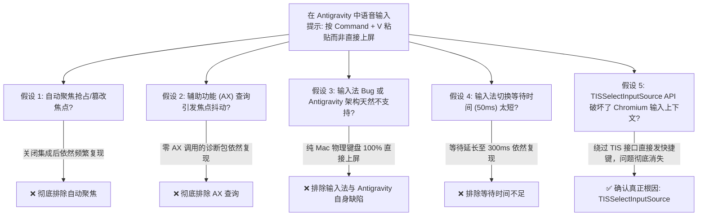
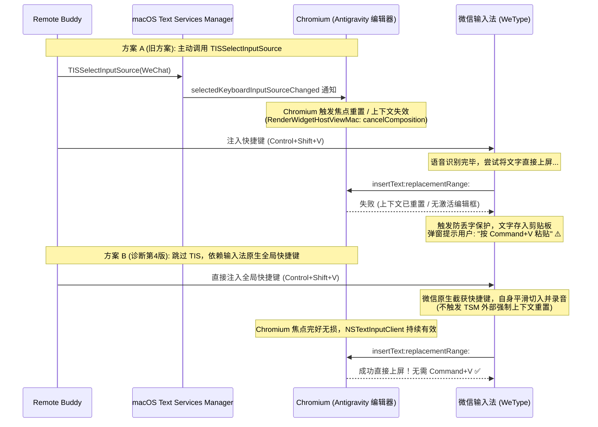
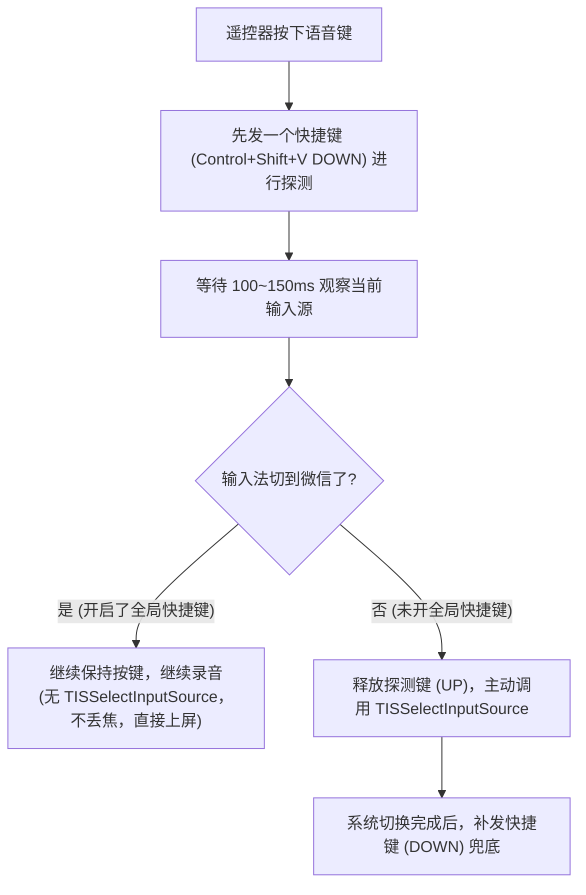
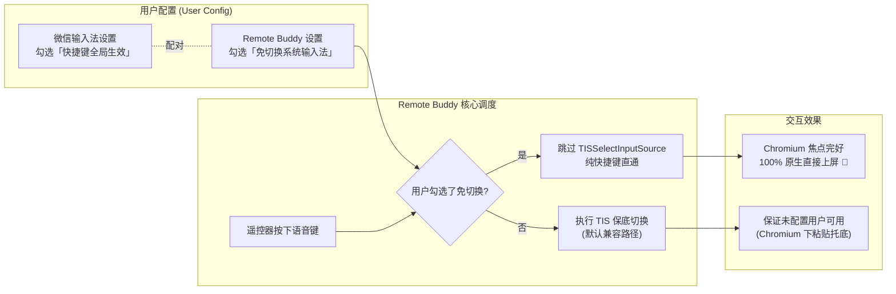

# 微信/豆包输入法在 Antigravity 中提示“Command + V 粘贴”而非直接上屏的排查与根因分析总结

## 1. 背景与问题定义

### 1.1 问题现象
在 macOS 上配合遥控器使用 **微信输入法 (WeType)** 或 **豆包输入法** 进行语音输入时：
- 在 macOS 原生应用（如备忘录 Notes、文本编辑 TextEdit、Safari 搜索框等）中，语音识别完成后文字能够**直接上屏（直接插入光标所在位置）**。
- 但在基于 **Chromium / Electron 架构的现代化开发环境（如 Google Antigravity、VS Code 等）** 中，经常出现**无法直接上屏**，而是输入法弹窗或气泡提示：
  > **“按 Command + V 粘贴”**（或只能以剪贴板粘贴方式写入文本）。

### 1.2 为什么必须根治该问题？
1. **打断用户沉浸体验**：用户使用遥控器语音输入的初衷是“按住说话、松手即出字”。一旦变成“只能 Command + V 粘贴”，用户需要额外的按键动作，甚至因光标焦点不准粘贴到错误位置。
2. **剪贴板污染**：降级为粘贴意味着每次语音识别都会冲掉用户剪贴板中已有的重要内容（代码片段、URL、密码凭证等）。
3. **交互不稳定性**：时而直接上屏、时而提示 Command + V，体验极不稳定，给用户造成“软件不可靠”的负面感知。

---

## 2. 全方位排查与五大假设对照验证

为了找出导致输入法放弃直接上屏、降级为 Command + V 提示的真实诱因，我们进行了多轮严密的假设验证与真机对照实验：



---

### 假设 1：是不是 Remote Buddy 的“自动聚焦 (Application Integration)”抢占或篡改了光标焦点？

- **怀疑点**：Remote Buddy 针对 Antigravity 提供了应用集成支持（检查当前聚焦元素是否为可编辑框）。按语音键时，辅助功能（AX）自动聚焦逻辑是否错误地移动了光标，导致微信输入法检测不到原来的输入框？
- **排查与日志核对**：
  - 检查会话日志（`remotebuddy.app-2026-11-20-session-B625BCFB.log`）：
    ```text
    02:01:18.234Z APP INTEGRATION preserved bundle=com.google.antigravity
    02:01:28.497Z APP INTEGRATION preserved bundle=com.google.antigravity
    ```
  - 日志证实：自动聚焦走的是 `preserveCurrentFocus()` 分支，系统判定当前光标已经在编辑区域内，**没有任何点击窗口动作、没有遍历窗口树，也没有写入 `kAXFocusedAttribute`**。
- **真机对照实验（关闭 Antigravity 应用集成）**：
  - 用户在设置中完全关闭了 Antigravity 应用集成。
  - 前几次测试看似正常，但随着连续测试（Step 2172、2263），**在集成彻底关闭、没有任何 `APP INTEGRATION` 逻辑运行的情况下，依然连续复现了“只能 Command + V”**。
- **结论 1**：**彻底排除自动聚焦。元凶不是应用集成与自动聚焦逻辑。**

---

### 假设 2：是不是 macOS 辅助功能 (AX) 的只读属性查询导致 Chromium 焦点抖动？

- **怀疑点**：虽然自动聚焦没有写入属性，但它调用了 `kAXFocusedUIElementAttribute` 和 `kAXValueAttribute` 的只读查询。Chromium 的渲染进程在跨进程响应 AX 查询时，是否引发了内部微小的焦点重置？
- **真机对照实验（第 1 版与第 2 版诊断包）**：
  - **第 1 版诊断包**：精简了属性查询，仅保留系统级轻量状态读取。
  - **第 2 版诊断包**：在代码中设置 `diag_no_ax = true`，**对 Antigravity 执行零 AX 调用（彻底掐断所有辅助功能通信）**。
  - **实测结果**（`3022FCCC.log`）：在完全没有发生任何 AX 通信的情况下，依旧复现了“只能 Command + V”。
- **结论 2**：**彻底排除 Accessibility 属性查询。**

---

### 假设 3：是不是输入法自身 Bug？或者是 Antigravity 自身完全不支持第三方输入法直接上屏？

- **怀疑点**：微信输入法在 Chromium/Electron 应用下本身就存在兼容性缺陷，或者 Antigravity 的输入框实现与原生 Cocoa 控件不同？
- **真机对照实验（纯物理键盘“去 Remote Buddy”基准对照）**：
  - 彻底退出 `Remote Buddy.app`，排除所有后台进程干扰。
  - 用户直接在 Antigravity 的输入框中，用 Mac 物理键盘按下 `Control + Shift + V` 启动微信语音输入。
  - 连续测试 10 次以上（包括从英文切入、连续长按、多次说话）。
  - **实测结果**：**纯物理键盘在 Antigravity 中 10 次测试全部 100% 成功直接上屏，一次都没有出现“按 Command + V 粘贴”！**
- **结论 3**：
  - **Antigravity 完全能够支持微信输入法直接上屏**。
  - **微信输入法自身在 Antigravity 下完全正常**。
  - **问题必定出在 Remote Buddy 的软硬件桥接流程中——Remote Buddy 执行了某项物理键盘没有执行的操作，正是这个操作打断了输入法上屏！**

---

### 假设 4：是不是输入法切换后的“稳定等待时间（settlingDuration）”太短？

- **怀疑点**：当系统当前输入法是英文（ABC）时，Remote Buddy 必须先切换到微信输入法才能发语音快捷键。原代码在检测到输入法 ID 变为微信后，只等待了 **50ms** 就立即发送 `Control + Shift + V`。是不是 50ms 太短，Chromium 还没来得及完成 Text Services Manager (TSM) 的客户端重新绑定？
- **真机对照实验（第 3 版诊断包）**：
  - 制作第 3 版诊断包，将切换输入法后的等待时间 `settlingDuration` 从 50ms 激进增加到 **300ms**（利用遥控器音频预缓冲机制，保证不吞音）。
  - **实测结果**（`D7E8A8CB.log`）：等待时间延长到 300ms 后，**第 1 次切换依旧弹出了“只能 Command + V 粘贴”**。
- **结论 4**：**不是等待时间长短的问题。哪怕等 300ms，问题依然存在。**

---

### 假设 5：真正元凶浮出水面 —— `TISSelectInputSource` API 对 Chromium 焦点的破坏

- **推论分析**：
  对比物理键盘测试与 Remote Buddy 流程，唯一的本质差异在于：
  - **物理键盘操作**：系统输入法无论之前是什么，用户直接按 `Control + Shift + V`。微信输入法开启了“快捷键全局生效”，微信自身捕获快捷键，在内部完成自切换并弹窗录音。
  - **Remote Buddy 操作**：Remote Buddy 发现当前输入法是 ABC，主动调用了 macOS Carbon 系统底层 API：`TISSelectInputSource(...)` 强制切输入法，然后再发送按键。
- **决定性验证（第 4 版诊断包）**：
  - 制作第 4 版诊断构建（`FE1EAB79.log`）：
    - 在微信输入法中勾选 **“快捷键全局生效”**。
    - 在 Remote Buddy 代码中硬编码 `diag_skip_source_prepare = true`，**彻底移除 `TISSelectInputSource` 的主动切换**（即完全不替输入法调用 TIS 接口，完全让输入法响应全局快捷键自我激活）。
  - **实测结果（Step 2324）**：
    > 用户反馈：**“好像不能复现了。”**
    - 经过反复连续多次测试，**“只能 Command + V 粘贴”的现象完全消失，文字 100% 全部直接上屏！**
- **结论 5**：
  **真相大白：导致“提示 Command + V 粘贴而非直接上屏”的真正元凶，正是 `TISSelectInputSource` 系统 API 调用！**

---

## 3. 根因深度剖析（Technical Deep Dive）

为什么 `TISSelectInputSource` 会导致 Chromium 提示 Command + V？底层机理如下：



### 3.1 Chromium / Electron 的 NSTextInputClient 实现机制
- Chromium 在 macOS 上的输入代理是 `TextInputClientMac`。
- 当系统输入源通过 `TISSelectInputSource` 发生外部切换时，macOS 会向激活的应用分发 `selectedKeyboardInputSourceChanged`。
- Chromium 在收到该事件时的标准行为是丢弃当前的 Marked Text，并重置输入法上下文（甚至暂时标记输入框为不可编辑），以防止旧输入法的未上屏拼音污染新输入法。
- 此时如果输入法尝试调用 `[textInputClient insertText:replacementRange:]`，Chromium 会直接忽略该调用。

### 3.2 微信输入法的“降级防丢字保护机制”
- 微信输入法具有极强的数据防丢失保护：当语音转文字成功后，它尝试上屏；一旦检测到当前目标应用程序的 `NSTextInputClient` 无法响应（返回 nil 或写入失败），微信输入法**绝不会丢弃用户的语音识别文本**。
- 它的安全策略是：
  1. 将识别结果文本复制到用户的系统剪贴板（Pasteboard）；
  2. 弹出气泡或悬浮窗提示：**“按 Command + V 粘贴”**。
- 因此，用户看到的这个提示，并不是微信输入法坏了，而是**微信输入法尝试直接上屏被 Chromium 拒绝后的降级托底行为**！

---

## 4. 探索“动态探测与兜底（Probe-then-Fallback）”的初衷、实测困境与底层机理

### 4.1 初衷与设计设想
明确了 `TISSelectInputSource` 是导致 Command+V 的元凶后，我们曾尝试在不改动用户设置的前提下，通过纯代码自动化解决：
- **理想假设**：如果输入法已经切过去了（用户开了全局快捷键），就不主动调 TIS；如果输入法没切过去，就用主动调 TIS 当保底。
- **实现的设想逻辑**：先发探测键（`Control + Shift + V` DOWN），等待 100~150ms 观察输入法是否自动切入。若未切入，释放探测键（UP）并调用 TIS 补发兜底。



### 4.2 现状澄清：当前 `main` 分支在“当前已是目标输入法”时的行为
在当前 `main` 分支代码中（`PreferredInputSourceMonitor.swift`），**“如果当前输入法已经是目标输入法，就不主动切”这一逻辑本来就是生效的**：
```swift
let previousInputSourceID = currentInputSourceID()
if previousInputSourceID == targetInputSourceID {
    logger("VOICE INPUT source_prepare tool=\(selectedVoiceTool.rawValue) result=selected managed=false")
    return true // 0 耗时，不调用 TISSelectInputSource，不丢焦！
}
```
这意味着：只要当前系统输入法本来就是微信，或者用户连续进行语音输入，系统从来不主动切，在 Antigravity 中也是 100% 直接上屏。矛盾**仅仅集中在当前输入法为 ABC、目标为微信的首次切入场景**。

---

### 4.3 动态探测的实测严重 Bug 与毫秒级时序还原

在 PR #227 中实现了上述探测逻辑后，用户在**当前为 ABC 且未开启全局快捷键**的环境下进行真机测试，发现了严重故障：
> **“按下语音键，微信语音悬浮窗短暂闪烁了一下，立即就停止了，无法继续说话。”**

通过抓取 Remote Buddy 调试日志（`1430B0BF.log`）与 macOS 统一日志（`WeType` 进程），我们将毫秒级时间线对齐，还原了崩溃的全貌：

| 时间点 (UTC) | 模块 | 动作与事件 | 内部真实机理 |
| :--- | :--- | :--- | :--- |
| **03:49:42.851** | Remote Buddy | `probe_sent` | 发送探测快捷键 `Control+Shift+V` **DOWN** |
| **03:49:42.868** | **WeType (微信)** | `AVCaptureSession startRunning` | **关键发现 1**：即使用户关闭了“全局生效”，微信也通过全局 CGEventTap 截获了按键，启动录音并开麦！ |
| **03:49:43.002** | Remote Buddy | `probe_failed` (151ms 超时) | 系统输入源仍为 ABC，Remote Buddy 误以为微信没响应，补发按键 **UP** 试图清理探测状态 |
| **03:49:43.008** | Remote Buddy | `source_prepare managed=fallback` | 调用 `TISSelectInputSource` 强制切换到微信输入法 |
| **03:49:43.201** | **WeType (微信)** | `AVCaptureSession stopRunning` | **致命冲突点 2**：微信收到 43.002 的按键 **UP**，由于微信是“按住说话”机制，判定用户松手，直接中止录音！ |
| **03:49:43.059** | Remote Buddy | `source_activation confirmed` | 确认系统切到微信，发送第二次快捷键 **DOWN** |
| **03:49:43.636** | **WeType (微信)** | `order window: 17608 op: 0` | 微信悬浮窗执行关闭动画，**正处于音频销毁与退出防抖闭包期，完全无视了第二次 DOWN**！ |
| **03:49:44.467** | Remote Buddy | 遥控器物理按键松开 (1.6s 之后) | 用户发现输入法早就关闭了，无奈松开遥控器 |

---

### 4.4 微信输入法的四大底层反常特质总结

1. **特质一：关闭“全局快捷键”依然会截获按键录音**
   - 微信设置里的“快捷键全局生效”开关，字面是“使用其他输入法时通过快捷键切换至微信输入法”。
   - **实测本质**：该开关**仅仅控制是否向 macOS 请求切换全局 `InputSourceID`**，它**从来不关闭自身的 CGEventTap 全局快捷键监听**！因此探测按键一旦发出，微信就必定开麦。
2. **特质二：150ms 释放按键（Key UP）变成了“强制掐断录音”指令**
   - 微信采用“按住说话”模式。当 Remote Buddy 因为检测到 `currentInputSource != WeChat` 而发送 Key UP 试图撤销探测时，微信直接判定用户松手，瞬间调用 `stopRunning` 销毁音频流。
3. **特质三：音频会话析构期间具有防抖/不可重入锁**
   - 从 Key UP 到补发 Key DOWN 仅相差约 57ms。微信音频捕捉流水线正在执行析构与上屏清理，处于不可重入状态，第二次 DOWN 被完全丢弃，导致用户无法继续说话。
4. **特质四：即便不释放按键强行在录音中切 TIS，仍会导致 Command + V**
   - 退一步设想：如果不释放探测按键，直接在微信已经开麦录音的过程中强行调用 `TISSelectInputSource` 会怎样？
   - 实测证明：macOS 依然会在录音中途向 Chromium 发送输入源变更通知，Chromium 依旧会重置 `TextInputClientMac` 上下文。微信在说完后尝试直接上屏，依然失败，**最终还是退化为弹出“按 Command + V 粘贴”**。

---

## 5. 核心死锁剖析：“信息黑盒”与“保底切换的必然性”

### 5.1 为什么“光让用户开全局快捷键”在当前代码下是个伪命题？
这是一个非常容易被忽视的死锁逻辑：
1. **当前代码现状**：在当前的 `main` 分支代码中，只要当前输入法是 ABC，Remote Buddy 就会**无条件调用 `prepareInputSource`（即 `TISSelectInputSource`）**。
2. **死锁产生**：即使用户在微信输入法里把“快捷键全局生效”打开了，**Remote Buddy 根本不知道用户开了**！
3. **结果**：当用户在 ABC 下按遥控器时，Remote Buddy 依然会抢先去调用 `TISSelectInputSource`，Chromium 依旧被重置焦点，微信依然只能弹出 Command + V 粘贴！

### 5.2 根本矛盾：跨进程“信息黑盒”
- **我们无法知道微信是否已经开始监听**：
  macOS 没有任何公开 API 能让一个普通进程去查询“第三方输入法当前是否正在采集音频 / 是否已经开启语音会话”。出于系统沙盒与隐私安全规则，Remote Buddy 既不能也不应侵入式刺探微信的私有状态。
- **保底切换是必须的**：
  因为 Remote Buddy 不知道微信有没有开始监听，为了保证在“用户没开全局快捷键”的绝大多数常规场景下按遥控器必定能打字，**Remote Buddy 就必须执行输入法的保底切换**。
- **只要保底切换，Chromium 就会丢焦**：
  一旦执行保底切换，`TISSelectInputSource` 就会触发 Chromium 重置输入上下文，从而直接导致 Command + V。

### 5.3 结论定理（The Architectural Impasse）
> **“除非我们不再做保底的切换，否则保底切换就一定会执行，而在 Chromium 中 Command + V 就必然会发生。  
> 消除 Command + V 的唯一物理路径，是彻底跳过保底切换；而跳过保底切换的前提，是必须确信输入法会自行激活。”**

---

## 6. 最终结论与工程应对方案

基于上述不可调和的系统级矛盾，我们总结出以下几种工程路径：

### 方案 A：Remote Buddy 增加显式开关（唯一能真正落地的解法）
在 Remote Buddy 的语音工具设置（针对微信/豆包）中增加一个显式勾选项：
> **`[ ] 输入法已开启全局快捷键（跳过输入法系统切换）`**
- **用户勾选后**：Remote Buddy 视为用户已自行配置好全局快捷键，**完全跳过 `prepareInputSource`（不调 TIS）**，直接向系统注入快捷键（如同第 4 版诊断包的 `diag_skip_source_prepare = true`）。
  - **效果**：在 Antigravity、VS Code 等所有编辑器中 **100% 原生直接上屏**，彻底消除 Command + V。
- **用户未勾选（默认）**：Remote Buddy 继续执行常规的 `TISSelectInputSource` 切换保底，确保普通用户不会因为未配置输入法而无法出字。

### 方案 B：保持当前代码不变，接受现状局限
- 如果不希望在 Remote Buddy 中增加配置项，则必须接受当前现实：
  在保持“无条件保底切换”的前提下，Chromium 类应用从 ABC 首次切入时出现“按 Command + V 粘贴”属于操作系统与 Chromium 机制决定的固有行为，无法在不引发录音闪退的前提下通过黑盒时序消除。

---

## 7. 架构思考与演进建议（Thoughts and Recommendations）

### 7.1 设计哲学的反思：显式优于隐式，声明优于探测
在 macOS 复杂的跨进程事件模型中，**“在黑盒之上做微秒级时序猜测与探测（Probe Hack）”是极度脆弱的反模式**：
- 合成的探测按键脉冲（Key Down -> Key Up）极其容易与第三方软件内部未公开的状态机（如音频捕获、去抖、模态窗口动画）产生不可逆的时序撞击。
- **正交设计准则**：当系统缺乏双向状态反馈协议时，**显式的配置声明（Explicit User Intent）远胜过脆弱的动态盲测（Blind Guessing）**。

### 7.2 推荐的工程落地实施路径（若后续规划实施）

如果未来要在 Remote Buddy 中彻底解决该体验瑕疵，推荐的完整工程演进步骤如下：



1. **数据模型扩展（AppSettings）**：
   在 `AppSettings.Onboarding.swift` 中为 `OnboardingVoiceTool` 增加快捷键直通配置：
   ```swift
   @AppStorage("voiceTool_bypassInputSourceSwitching")
   var bypassVoiceToolInputSourceSwitching: Bool = false
   ```
2. **核心逻辑联动（PreferredInputSourceMonitor）**：
   在 `beginVoiceSession` 中判断：若当前配置了 `bypassInputSourceSwitching == true` 且目标为微信/豆包，直接返回 `true` 并打印 `result=bypassed_by_user_config`，完全旁路化 `TISSelectInputSource`。
3. **设置界面（Settings View）交互文案**：
   在设置面板中以小贴士形式展现：
   > `[x] 免切换输入源（直接上屏模式）`  
   > *说明：需先在微信输入法设置中开启「快捷键全局生效」。开启后可在 Antigravity、VSCode 等代码编辑器中实现 100% 原生直接上屏，彻底消除 Command + V 粘贴提示。*
